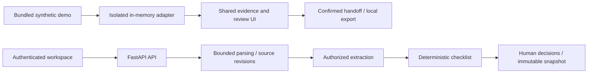

# MediTrace — Referral Review Copilot

A synthetic-data portfolio prototype for staff checking referral documents: find missing information or conflicting details, inspect the source evidence, record a human decision, and export a versioned handoff.

**Start here:** [80-second captioned rough cut](docs/portfolio/media/referral-demo-rough-cut.mp4) · [Run the demo locally](#try-the-demo) · [Evaluation and failures](evals/referral-review/README.md) · [Code](https://github.com/zfz193071/meditrace)

**Status:** the English landing page, three fixed demos and offline evaluation are implemented. This V1 is not fully accepted or deployed. No clinical validation, customer adoption or time-saving claim is made. The video is an edited still-frame walkthrough of actual offline UI, not live model inference. A verified public V1 demo URL will be added after the release gates pass; an older deployment is not evidence of the current build.

## Try the demo

Prerequisites: Node.js 22 and pnpm 10.34.7. From a checkout, run these commands manually:

```bash
pnpm --dir src/frontend install --frozen-lockfile
pnpm --dir src/frontend dev
```

Open [the local demo](http://localhost:3000/demo). The frontend-only `/demo` needs no backend service, account, payment credentials or model key. It uses bundled synthetic sources and precomputed results. Do not enter real patient information.

1. In the identity case, compare both highlighted dates of birth. Choose **Keep unresolved**, enter a reason and save each of the two findings.
2. Confirm the handoff and download, copy or print it. The unresolved identity warning remains visible.
3. Switch to the missing-report case. **Load prepared revision** makes the old result read-only; **Load prepared result** displays the fixed newer result. Neither action calls a model.
4. Reset, switch cases or refresh to discard local edits. Visitor inputs are not persisted by the demo adapter.

The landing page is `/`; measured offline results and limitations are at `/evaluation`. `/workspace` is a separate authenticated backend flow with additional configuration and outstanding external integration acceptance. The private workspace is not required to understand the public examples.

## Architecture and engineering choices



- **Evidence before summaries:** citations carry source document, page, Unicode code-point offsets and text hash. A matching quote proves location, not semantic correctness; the evaluation includes a historical-template failure.
- **Versioned review:** source changes invalidate earlier runs for new decisions. Reviewer corrections are separate from the original extracted facts. Confirmed snapshots preserve the review context.
- **Controlled execution:** backend code separates create, execute and read-only status. Dispatch markers, idempotency and cost reservations address retries and unknown outcomes. PostgreSQL concurrency and real-provider acceptance remain pending; this is not an exactly-once provider guarantee.
- **A shared interface:** the demo and workspace reuse evidence, review, history and handoff components. The demo adapter has no server writes and is not proof of backend authentication or persistence.
- **A bounded scope:** no diagnosis, triage, clinical completeness judgment, OCR, HealthLink or hospital-system integration. The prototype has not been validated against New Zealand clinical workflows.

Implementation guides: [architecture](docs/referral-review/ARCHITECTURE.md), [domain and API](docs/referral-review/DOMAIN-AND-API.md), [glossary](GLOSSARY.md), [implementation and acceptance status](docs/referral-review/README.md).

## Evaluation: what the evidence supports

The checked-in development run contains ten synthetic packets: nine readable packets and one rejected scan. It compares a line-reader baseline, scripted Fake output passed through the production extraction validator/checklist, and replay of that recording. **There is no real-model accuracy score.**

| Development-only measurement | Baseline | Fake pipeline | Replay of Fake |
| --- | --- | --- | --- |
| Fact TP / FP / FN | 69 / 5 / 4 | 71 / 3 / 2 | 71 / 3 / 2 |
| Finding TP / FP / FN | 9 / 1 / 1 | 10 / 1 / 0 | 10 / 1 / 0 |
| Accepted facts with intact citations | 74 / 74 | 74 / 74 | 74 / 74 |
| Clean packets with an extra finding | 1 / 2 | 1 / 2 | 1 / 2 |

Annotations are provisional pending operator review. Real-model tokens, cost, latency and independently verified semantic support are unmeasured. The twenty-packet frozen split has not received the required real quality evaluation. Tests passed are engineering regression evidence, not clinical accuracy or business impact.

[Metric definitions and commands](evals/referral-review/README.md) · [Failure analysis](evals/referral-review/FAILURES.md) · [Latest implementation evidence](docs/referral-review/MT-20-EVIDENCE.md).

<a id="本地开发"></a>

## Development and verification

The frontend is Next.js / React / TypeScript; the backend is Python 3.12 / FastAPI. Local persistence uses SQLite; PostgreSQL is the target production database. Backend setup uses a virtual environment:

```bash
cd src/backend
uv sync --frozen
# Review .env.example and configure only the services you intend to use.
# Preserve existing environment files; do not copy over them blindly.
./.venv/bin/python main.py
```

Backend services are started/stopped manually. See [configuration](docs/referral-review/CONFIGURATION.md), [migrations](docs/referral-review/MIGRATIONS.md), and [deployment operations](BACKEND-DEPLOYMENT.md). Deployment is a separate gated task; installing dependencies does not authorize paid model use.

Useful offline checks, from the repository root:

```bash
pnpm --dir src/frontend typecheck
pnpm --dir src/frontend test --runInBand
pnpm --dir src/frontend build
PYTHON_DOTENV_DISABLED=1 DATABASE_URL=sqlite:///:memory: src/backend/.venv/bin/python -m pytest src/backend/tests/referral_review -q
src/backend/.venv/bin/python evals/referral-review/run.py --provider fake --output /tmp/meditrace-fake-evaluation
```

Choose a new evaluation output directory for each run. The evaluation CLI currently rejects real execution even with a cap: independent evaluation accounting and global reservation integration remain unfinished. Never automate browser AI generation, including fake generation buttons; fixed-result navigation, review and export are allowed.

## Delivery limits and contribution provenance

OAuth/Private Blob/Stripe and PostgreSQL acceptance, operator annotation review, authorized real evaluation, complete integration and final deployment remain outstanding. Legacy diagnosis/chat/blockchain code is historical and has not yet been retired; new budget controls must not be assumed to protect those older endpoints.

Development has used an AI coding assistant for implementation, tests and documentation under project instructions. Automated checks and reviewed artifacts are linked; they do not prove that the project owner personally wrote or independently reviewed every line. The [interview and authorship guide](docs/portfolio/INTERVIEW.md) separates repository evidence from personal claims that require confirmation.

[Portfolio materials](docs/portfolio/README.md) include the captioned rough cut, technical walkthrough, role-specific project bullets and unsent outreach drafts. They remain drafts until the owner verifies their personal claims and the remaining acceptance gates are completed.

## License

No repository-wide `LICENSE` file is currently present; the previous README's MIT label was not accompanied by a license grant. No new repository license is asserted here. Synthetic fixture reuse terms are in [the fixture license](fixtures/referral-review/LICENSE.txt); the bundled font has [separate terms](fixtures/referral-review/BITSTREAM-VERA-LICENSE.txt). Third-party dependencies retain their own licenses. The owner must confirm a repository-wide license before presenting this as licensed open-source software.
