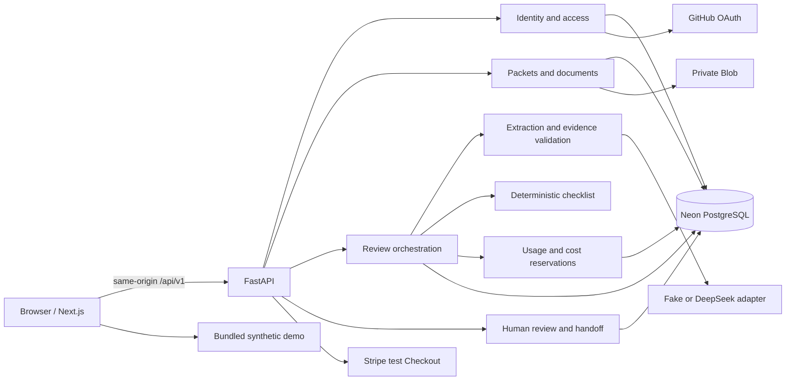

# 架构与模块设计

状态：V1 已选定架构，尚未实现。范围与配额的唯一来源为 [PRODUCT](PRODUCT.md)，数据／状态／接口的唯一来源为 [DOMAIN-AND-API](DOMAIN-AND-API.md)。

## 总体结构

采用模块化单体：Next.js 负责页面与交互；FastAPI 负责身份、权限、资料、核对、计费和导出；Neon PostgreSQL 负责持久状态与事务；Vercel Private Blob 保存来源文件。单个代码仓库、现有 Vercel 项目和域名，保留 Services 路由结构。



全站 `/api/*` 已路由到 FastAPI，因此登录回调、支付回调、文件下载也由 FastAPI 实现，不另建同名 Next.js API Route。浏览器只访问同源业务接口；模型、Blob 和支付凭据不进入浏览器。

## 技术选择与兼容处理

| 位置 | 决策 | 原因与实现要求 |
| --- | --- | --- |
| UI | Next.js App Router、React、TypeScript、Tailwind | 复用现有体系；MT-01 核实受维护稳定版本并固定锁文件，不把当前旧依赖照搬成最终版本 |
| 后端 | FastAPI、Pydantic、SQLAlchemy 2 | 新领域使用显式仓储和事务，不扩展旧 qmark SQL 兼容层 |
| 数据库 | Neon PostgreSQL；SQLite 仅快速本地测试 | 并发、锁和费用原子性必须在 PostgreSQL 集成测试验证 |
| Schema 迁移 | Alembic，独立 `rr_` 新表 | 旧表不删除、不改写；显式迁移，服务启动不做 DDL |
| 文件 | Vercel Private Blob；本地私有文件 Adapter | 2 MiB 单文件经 FastAPI 上传；不引入直传和大文件分块 |
| PDF 文本 | pypdf | 提取按页文字、页状态；隔离解析进程和资源上限；不承担 OCR |
| 身份 | GitHub OAuth，Authlib 客户端；数据库不透明会话 | 用户是开发者／评审人；不自建密码系统，不按邮箱自动合并身份 |
| 模型 | 现有 DeepSeek HTTP 基础设施，新独立提取 Adapter | 固定 JSON Schema、一次请求、无工具调用；真实与 Fake Adapter 同 Interface |
| 支付 | Stripe Checkout，payment 模式，测试环境 | 一次购买固定期限会员；避免续费与订阅生命周期扩大首版范围 |
| 输出 | 确认快照 → 纯函数交接模型 → fpdf2／文本 | 复用 PDF 技术基础；不复用诊断报告模板或 IPFS 上传 |
| 测试 | pytest、PostgreSQL 集成、现有前端测试体系、隔离 E2E | 浏览器自动化只做固定示例和人工审核动作；不自动触发 AI／模型模拟运行 |

依赖版本、包大小及 Vercel Python 运行环境在 MT-01、MT-24 验证并锁定，不依赖 beta 平台能力。任何无法在既有部署中运行的关键依赖必须在基础工单解决，不能留到最终验收才发现。

## Module 与 Interface

以下名称也是实现目录名。Interface 是模块公开操作、约束和失败模式的总和；内部可以拆文件，调用方不依赖内部表或供应商 SDK。

| Module | Interface | 内部负责的复杂性 | 关键失败结果 |
| --- | --- | --- | --- |
| `identity` | `authenticate`, `require_owner`, `logout` | OAuth、会话、CSRF、账号停用 | 401、404、CSRF_INVALID |
| `documents` | `ingest`, `read_page`, `read_original`, `delete` | 上传限制、私有对象、解析、归属、对象清理 | FILE_UNSUPPORTED、PARSE_FAILED、STORAGE_UNAVAILABLE |
| `packets` | `create`, `save_revision`, `get`, `delete` | 不可变成员集合、revision 乐观并发、过期标记 | REVISION_CONFLICT、PACKET_LIMIT |
| `extraction` | `extract(revision, model_config) -> Extraction` | 提示词、结构验证、引用校验、供应商响应 | MODEL_INVALID_OUTPUT、EVIDENCE_INVALID、MODEL_UNAVAILABLE |
| `checklist` | `evaluate(extraction, manifest, checklist) -> Findings` | 完整性、身份差异、附件与时间语义 | CHECKLIST_UNSUPPORTED；无网络和数据库写入 |
| `usage` | `reserve`, `settle`, `retain_unknown`, `grant` | 会员、次数、总预算、并发、原子账本 | MEMBERSHIP_REQUIRED、QUOTA_EXHAUSTED、BUDGET_EXHAUSTED |
| `runs` | `create`, `execute`, `get`, `reconcile` | 请求幂等、单次派发、状态机、lease、结果固化 | RUN_ACTIVE、SOURCE_CHANGED、OUTCOME_UNKNOWN |
| `reviews` | `apply_resolution`, `edit_handoff`, `confirm` | 人工记录、review_version、快照、身份警示 | REVIEW_CONFLICT、OPEN_FINDINGS、STALE_RUN |
| `handoff` | `render(snapshot, format)` | 固定事实布局、证据清单、多页排版 | SNAPSHOT_NOT_FOUND、EXPORT_TOO_LARGE |
| `billing` | `create_checkout`, `handle_event`, `get_membership` | 服务端金额／商品、签名、事件去重、退款 | BILLING_DISABLED、PAYMENT_PENDING、EVENT_REJECTED |
| `lifecycle` | `expire`, `purge`, `reconcile_objects` | 到期／主动删除、事务外清理补偿、最小审计 | PURGE_PENDING；失败可重入 |

`checklist` 不访问模型，`extraction` 不修改会员，`reviews` 不发起模型请求。编排仅在 `runs` 内；路由模块负责身份、参数、调用 Interface 和 HTTP 映射。

真正需要 Adapter 的 Seam 只有外部差异：模型（Fake／DeepSeek）、对象存储（本地／Private Blob）、支付（测试事件／Stripe）和时钟。SQLAlchemy 统一持久化，不为每个表引入无价值的接口层。测试调用模块 Interface，避免模拟每个内部函数。

## 建议目录

```text
src/backend/
  referral_review/
    schemas/                 # Pydantic transport and domain contracts
    identity/ documents/ packets/ extraction/ checklist/
    usage/ runs/ reviews/ handoff/ billing/ lifecycle/
    routes.py config.py errors.py
  migrations_referral/       # Alembic env + versioned additive migrations
  tests/referral_review/
src/frontend/
  app/demo/ app/workspace/ app/account/ app/evaluation/
  features/referral-review/  # typed views, review state, evidence text views
  lib/referral-api/          # generated types + small typed fetch client
contracts/referral-review/   # exported OpenAPI/schema fixtures, generated provenance
fixtures/referral-review/    # synthetic documents, labels, frozen demo results
evals/referral-review/       # runner, manifests, versioned reports
docs/referral-review/        # this specification and implementation tickets
```

目录是落地指导，不要求一次创建所有空壳。Pydantic/OpenAPI 是传输契约单一来源，前端类型自动生成并在 CI 检查差异；演示、Fake 和真实响应都必须符合该契约。

## 执行与恢复

文件逐个上传、逐个解析，全部成功且用户保存资料版本后才能运行。AI 核对用两步请求：创建 pending 批次，再显式 execute。execute 在当前请求内 await 到完成或失败；前端可以并行 GET 批次查看状态，GET 不派发任务、不调用 AI。

应用级执行总时限 180 秒，模型 HTTP 总时限 120 秒，批次 lease 240 秒，Vercel 函数目标上限 300 秒；前端执行请求超时 195 秒后停止等待并查询状态。不能把已返回的 HTTP 202 误认为存在常驻 worker。关闭浏览器后不保证任务继续，持久状态可重新打开查询。

执行只在服务端 CAS 成功后开始，SDK／HTTP 自动重试关闭。模型调用前持久化 `provider_dispatched_at`；在调用结果不能确定时记 `outcome_unknown`。重新运行由用户新建批次并重新预留预算，界面说明可能已有供应商费用；同一批次绝不因刷新／GET／网络重试再派发模型。细则见领域状态机。

## 外部资料与内部页面

- 文档内容是待提取数据，不能执行其中的指令；模型无网络、无工具权限、无文件路径访问能力。
- 每个原文件 URL 通过文档 ID 查表和归属校验，不接受任意 URL／对象路径。前端按纯文本呈现摘录，不能执行 PDF 脚本或模型返回 HTML。
- 非公开业务响应、原文件和导出使用 `Cache-Control: private, no-store`；静态合成 demo 可以公开缓存。
- 解析在子进程内设超时／输出／资源上限；单文件 2 MiB 并不能防止 PDF 解压膨胀，须同时限制解析输出与页内容流。

## 部署迁移

新增 `/api/v1/*` 不复用 `/api/diagnose` 或旧会话表。发布时关闭旧读写／流式／上传／链上接口，返回统一 410，不再实例化旧 Web3/IPFS 客户端。旧数据保留，旧页面转到带说明的新入口。

发布脚本现有 `/api/conversations` 探测替换成 GET `/api/v1/readiness`，检查数据库连通、迁移版本和清单就绪，不返回资料、不调用模型。迁移只执行已审核的 referral migration ID 集合，不能自动跑旧 DROP TABLE SQL。迁移后回滚应用不会自动撤销表；回滚只能选用已关闭旧公开资料接口的安全版本，不能恢复旧暴露面。

## 核实的外部依据

- Vercel 函数请求／响应有 4.5 MB 上限；Fluid Compute 的 Hobby 函数当前上限 300 秒。单文件和执行时限据此收窄，MT-24 再验证实际项目配置。[官方限制](https://vercel.com/docs/functions/limitations)
- Private Blob 需要服务端鉴权；敏感响应适合 no-store。不可变对象路径避免覆盖读取的一致性问题。[Private Storage](https://vercel.com/docs/vercel-blob/private-storage)
- pypdf 的文字提取不等同 OCR，扫描件和布局复杂的 PDF 有能力边界，因此必须显示解析失败与不支持。[pypdf 说明](https://pypdf.readthedocs.io/en/stable/user/extract-text.html)
- Stripe 权益发放应由服务端支付验证驱动，并处理重复和乱序事件；前端成功返回不能作为到账依据。[Checkout fulfillment](https://docs.stripe.com/checkout/fulfillment)、[Webhooks](https://docs.stripe.com/webhooks)

以上为 2026-10-20 查阅结果；外部规格变化时更新相关工单及记录，不自动更换平台或升级收费套餐。
