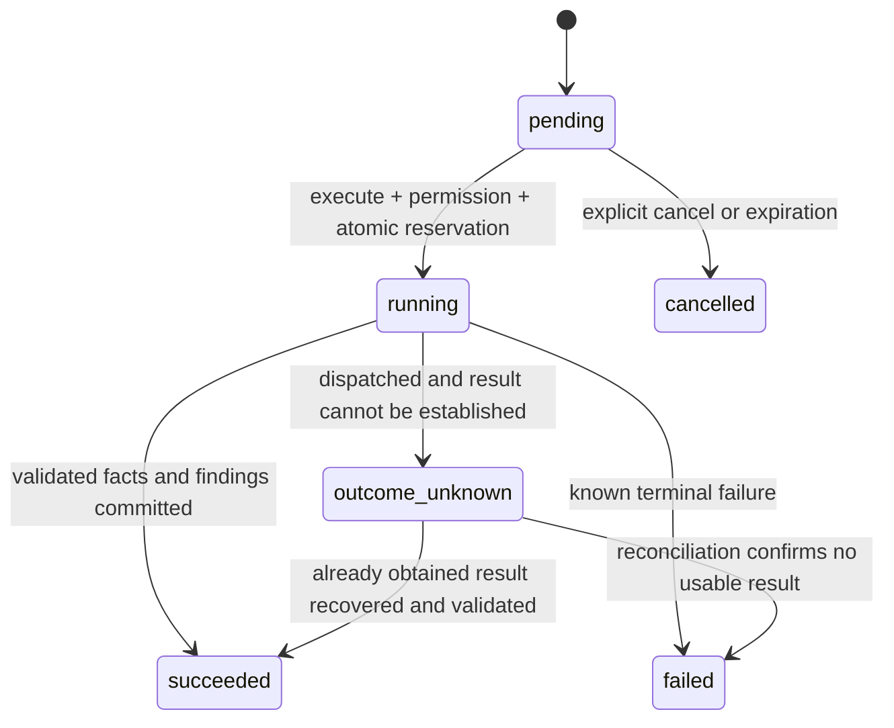

# 领域模型、状态与接口契约

## 通用约定

- ID 为服务端 UUID；时间为 UTC ISO-8601，界面按用户时区显示。日期原文与规范值分开，不推算缺失年份或歧义日期。
- 账号来自服务端会话，客户端不得设置 `owner_id`。所有关联查询验证最终 Packet 归属，越权和不存在统一 404。
- 提交新版本用 `expected_revision`；修改审核用 `expected_review_version`；冲突返回 409 及当前版本，不能静默 last-write-wins。
- 资料／审核／运行／订单创建与变更操作使用 `Idempotency-Key`。服务端唯一范围为 `(owner, operation, key)`；同 key 同 payload 返回原结果，同 key 不同 payload 返回 409；默认保留 7 天。支付事件与订单以供应商 ID 单独去重，按本文件末尾的保留策略管理。会话退出、OAuth callback、维护和供应商 webhook 使用各自的幂等／认证规则。
- 错误格式 `{ "error": { "code": "...", "message": "...", "retryable": false }, "request_id": "..." }`。错误不能泄露原文、密钥、供应商响应体或其他账号存在性。
- API 分页用不透明 cursor，默认 20、最大 50；排序固定为 `(created_at desc, id desc)`。

## 数据实体

以下是实施必须覆盖的逻辑字段；实现时可合理拆分索引和 JSON 字段，但保持约束。

| 表（`rr_` 前缀） | 主要字段及约束 |
| --- | --- |
| users | id、github_subject 唯一、display_name、created_at、disabled_at；不以显示名／邮箱作为身份 |
| sessions | token_hash 唯一、user_id、csrf_secret、expires_at、revoked_at；数据库不存 cookie 原值 |
| oauth_states | state_hash 唯一、browser_nonce_hash、encrypted_verifier、return_path、expires_at、consumed_at；10 分钟、一次性 |
| packets | id、owner_id、title、current_revision、review_version、created_at、updated_at、expires_at、deleted_at |
| documents | id、packet_id、owner_id、kind、filename、sha256、storage_key 唯一、byte_size、parse_status、parser_version、created_at、deleted_at；文件内容不可变 |
| document_pages | document_id、page_number、normalized_text、text_hash、parse_quality；页码从 1 起；唯一 `(document_id,page_number)` |
| revisions | id、packet_id、revision_number、manifest_hash、created_at；唯一 `(packet_id,revision_number)` |
| revision_documents | revision_id、document_id、ordinal；同包文件成员集合，不能引用其他包文件 |
| runs | id、packet_id、revision_id、checklist_version、mode、state、input_hash、prompt_version、schema_version、model_requested、model_reported、lease_expires_at、provider_dispatched_at、provider_request_id、usage、error_code、created_at、finished_at |
| facts | id、run_id、field_key、value_raw、value_normalized、assertion_status、temporal_context、evidence_ids；含否定／未知语义 |
| evidence | id、run_id、document_id、page_number、start_cp、end_cp、quote、text_hash；归属当前 run 版本且 quote 精确等于文字切片 |
| findings | id、run_id、rule_id、kind、field_keys、fact_ids、evidence_ids、checked_document_ids、message；结果本体不可变 |
| resolutions | id、finding_id、actor_id、action、reason、corrected_value、linked_evidence_ids、review_version、created_at；append-only |
| handoff_drafts | packet_id、run_id nullable、revision_id、content、review_version；用户补充标注 provenance |
| review_snapshots | id、packet_id、revision_id、run_id nullable、review_version、confirmed_by、confirmed_at、payload、payload_hash、has_unresolved；内容不可变 |
| memberships | id、owner_id、source_order_id 唯一、environment、valid_from、valid_until、granted_units、reserved_units、consumed_units、revoked_at |
| orders | id、owner_id、environment、checkout_session_id 唯一、payment_intent_id 唯一可空、price_id、amount、currency、state、paid_at |
| billing_events | stripe_event_id 唯一、event_type、object_id、state、received_at、processed_at；不存完整支付事件个人信息 |
| usage_reservations | id、run_id 唯一、membership_id、units、cost_upper_bound_microusd、actual_microusd、state、price_version |
| budget_buckets | bucket_key 唯一（UTC 日／月）、limit、reserved、spent；整数 micro-USD，禁止 float |
| concurrency_slots | scope（账号／全站）、slot_number、run_id、lease_expires_at；唯一 slot，数据库锁保护 |
| storage_reservations | id、owner_id、document_id 唯一、reserved_bytes、state、expires_at；账号／全站存储桶行锁保护配额 |
| rate_limit_buckets | scope、action、window_start、count；唯一组合，账户维度为主，IP 以短期加盐哈希保存 |
| idempotency | owner_id、operation、key、request_hash、resource_id、expires_at；唯一组合 |
| audit_events | id、actor_id、packet_id nullable、action、revision_id nullable、run_id nullable、request_id、created_at；不存全文 |
| cleanup_jobs | object_key／entity_id、kind、state、attempt_count、next_attempt_at、last_error_code；可重入和重试上限 |

外键、唯一约束与状态 CHECK 在 DB 层实现；业务层再次校验。源内容存储在 documents/pages，事实和快照是派生内容，删除必须覆盖两者。用户删除后，财务记录中账号引用去标识化，保留避免重复发权益所需的最小记录。

orders 的 pending 状态对 `(owner_id,environment)` 建部分唯一约束，防止两个不同 idempotency key 创建多个同时有效 Checkout。会员激活锁定 user 行，再检查有效期和订单唯一键；不能仅以“先查询没有会员”防并发。

## Fact 与 Evidence

`assertion_status` 为 `stated | explicitly_none | unknown`；未提及由规则计算 `not_provided`，不能生成“没有”的 Fact。事实字段允许多个相互矛盾值，不以 last-write-wins 合并。

`field_key` 首版固定为 `patient.name`、`patient.dob`、`referrer.name`、`referrer.contact`、`recipient`、`referral.reason`、`medications`、`allergies`、`attachment_reference`、`report.description`。药物、报告事实可含原文日期、药名、数值及单位，但不作医学解释。

页文字规范化版本 `text-v1`：统一换行为 LF、Unicode NFC、保留段落与大小写；不做全局空白折叠。保存此版本后不原地更改。offset 是 Unicode code point 的半开区间 `[start_cp,end_cp)`，前端须使用 `Array.from(text)` 或等价映射，不能直接用 UTF-16 索引。

模型返回 `document_id/page_number/quote` 和可选相邻上下文，服务端在指定页唯一定位再产生 offsets。引用不存在、歧义未消除、跨其他资料版本、切片与 quote 不同，一律不能成为有效 Evidence。该 Fact 被拒绝；若任何必需提取字段的引用无效，整个运行以 `MODEL_INVALID_OUTPUT` 失败，不将残缺结果呈现为成功。

“缺失”没有可引用的不存在原文：Finding 必须包含 rule_id、checklist_version、checked_document_ids 和解析覆盖说明，展示“在本次提供且成功解析的资料中未找到”。附件提示可引用“见附件”的原句；不能伪造缺失附件中的文字。

## 规则、身份与时间

Finding.kind 为 `missing | unknown | identity_mismatch | statement_difference | attachment_unmatched | parse_quality`，不使用医疗高／中／低风险。

- 姓名仅做 trim、空白与大小写规范化，不做音译／昵称／模糊归并；多个值产生待核对事项。
- 完整、无歧义 DOB 标准化后比较；`03/04/1980` 没有格式信息时不强行转换。
- 不同日期的用药剂量变化不是自动冲突；只有相同明确时间背景的直接相斥陈述可提示 statement_difference，其余展示在事实列表供人核对。
- 模型可提出差异候选，但规则引擎必须验证参与事实、字段和时间背景；不直接展示自由文本“风险分析”。
- `attachment_reference` 与 manifest 的标题／类型候选匹配仅用于筛查；匹配不明确时仍标记待人工核对，不自动宣告已齐全。
- 图片／解析失败不被当成“没有资料”；资料版本包含不可读页时禁止 AI 执行，手动模式仍可记录“未核对原件”。

## 状态机

### Document

`uploading → parsing → ready | rejected | failed`。上传和解析各在当前请求中完成；API 重试复用同一 Document。失败可以提交新 Document，不原地替换已 ready 内容。并发上传用数据库预留文件数和字节配额，完成／失败后结算，不能仅靠前端计数。

### Review Run

- `pending` 不预留模型费用，30 分钟后到期，不能在 GET 中自动执行。
- execute 事务锁定 run、会员、预算桶与并发槽；固定加锁顺序防死锁。权限／输入检查通过才 reserve，提交后才调用模型。
- `running` 时重复 execute 返回 202 和当前 run；`succeeded` 返回已有结果；终态失败返回已有终态。它们均不再次请求供应商。
- 事务外调用前写入派发标记。实例退出后 lease 到期：没有派发标记可标记 failed 并释放费用；有标记则 outcome_unknown。恢复通过显式 `POST reconcile` 或每日维护执行，GET 无此副作用。
- 保留 unknown 的费用最高预留值；24 小时仍不可核实时记为保守估计花费，不退回总预算。成功次数可释放，但失败频率／总预算仍限制重试。账号并发槽在 lease 到期后释放；这只约束本应用活跃执行，不宣称取消了供应商远端任务。
- 结果与费用结算失败时保留 run_id 和可恢复记录；没有持久化的返回不能在下次重新请求供应商获取。允许因此进入 unknown，UI 提供明确说明。
- 无自动“取消供应商请求”承诺；运行中只允许离开页面。删除资料包立即屏蔽读取，运行返回时检测 tombstone，丢弃内容并按已产生用量结算。

### 资料变更与审核

Packet 的内容版本与审核版本独立。Document 集合变化递增 revision；人工操作递增 review_version。run 的 `stale` 为其 revision 不等于当前 revision 的派生值，不覆写 run 状态。

新版本不会自动重跑，不复制旧 Resolution。旧结果可查看，当前审核操作返回 STALE_RUN；新 run 重新开始审核，旧人工修改作为历史参考而非自动生效。执行期间可新增版本，旧运行完成后保存为历史且显示过期。

Finding 初始 `open`，Resolution.action 为 `resolve | dismiss | defer | reopen`。有效状态由最后一条 Resolution 推导；`defer` 对应 unresolved。纠正事实是人工补充覆盖层，不改动模型 Fact；用户修改也不能修改原文 Evidence。

确认要求没有 open 事项、revision 与 review_version 匹配、当前 run 成功，或显式 manual 模式。确认产生快照；之后编辑派生为新 review_version，旧快照不动。manual 模式全部内容标明人工整理／未经自动核对，不生成伪造 Fact 或模型成绩。

## 身份、会话与 CSRF

GitHub OAuth 使用稳定 provider subject；只申请必要的身份权限，不需要仓库写权限。state、PKCE（在供应商支持的配置中）、浏览器 nonce 与回跳白名单由成熟 OAuth 客户端处理，state 一次性且 10 分钟过期。回调失败不创建已登录会话。

随机不透明 session token 至少 256 bit，DB 只存哈希；有效期 7 天、无无限滑动续期。生产 cookie 为 HttpOnly、Secure、SameSite=Lax、Path=/，退出立即撤销。`GET /auth/session` 返回用户与 CSRF token，所有 cookie 认证的变更接口要求 Origin 白名单和 CSRF header；OAuth callback 与 Stripe webhook 使用各自的认证机制。

演示访客不持久化任意用户输入。登录后草稿先保存后支付跳转；回调 URL 只包含已授权 packet_id 和安全相对路径，不包含原文。页面状态保留最近保存版本，未保存变化离开前提示。会话到期后重新登录同一账号恢复服务端草稿；不能把患者文本写到 localStorage 或 URL。

## 权益与成本账本

每个环境、账号最多一个有效会员期；尚未过期时禁止重复购买／叠加。支付回调在事务中创建固定 30 天、20 次会员；到期重新购买创建新期，不结转额度。成功核对消费 1 次，失败／unknown 不消费成功次数，但仍计入供应商费用和失败频率。

测试付款只产生 sandbox entitlement。真实调用额外要求邀请名单与开关；两者不能从客户端或 Stripe metadata 自行传入。模型模式在 run 创建时服务端决定，前端不能指定 `real` 绕过开关。未受邀的沙箱账号只有模拟模式，页面始终标识。

费用用整数 micro-USD。调用前按已配置价格版本、保守输入上界及最大输出计算上界，在日和月桶同时预留；使用不依赖缓存折扣的最高适用输入单价。最终按供应商 usage 结算。缺失 usage 使用上界估计；实际成本异常超上界时记录异常并关闭新真实任务，不能负余额后继续调用。

默认日／月预算均为 0，缺模型价格配置 fail closed。预算预留归属于开始时的 UTC 日／月桶，跨午夜仍在原桶结算，不能释放到新桶。限流先于付费调用：每账号最多 3 次 execute 尝试／分钟、20 次／小时；每天最多 10 次失败或 unknown，后续需等下个 UTC 日或运维处理。成功次数仍受会员额度控制。IP 仅作为辅助异常信号，所有限流采用共享存储，不依赖进程变量。

usage_reservation 状态固定 `reserved | settled | released | retained_unknown | estimated_spent`；settled 的已知实际费用和 estimated_spent 的保守估计在报告中分开。已经 settled 的记录不能二次释放；迟到的可信 usage 只能以追加调整账记录纠正，不直接覆盖历史账目。存储额度同时包含在途上传和已持久文件，过期的在途预留经维护释放；已写入但 DB 失败的对象计入待清理空间，不提前虚增可用容量。

## HTTP 路由

前缀 `/api/v1`；除明示 public 外均需 session。所有 packet 子资源均检验 owner。下面的 UUID 参数简称 `pid/did/rid/sid`。

| 方法与路径 | 输入／输出和关键约束 |
| --- | --- |
| GET `/capabilities`（public） | 可展示模式、文件限制、付款是否沙箱；不暴露名单和密钥 |
| GET `/readiness`（public） | `{status,schema_version,checklist_version}`；DB／迁移失败 503，无业务数据 |
| GET `/auth/github/start`（public） | 白名单 return_path；302 OAuth |
| GET `/auth/github/callback`（public） | state/code 验证，设置 cookie，303 回安全页面 |
| GET `/auth/session`（public） | 未登录 `{user:null}`；已登录含 CSRF，不缓存 |
| POST `/auth/logout` | 撤销当前会话；204 |
| GET/POST `/packets` | 列表／`{title,synthetic_data_ack:true}` 创建；201 |
| GET/PATCH/DELETE `/packets/{pid}` | 聚合状态／标题变更／立即 tombstone + 202 cleanup |
| POST `/packets/{pid}/documents` | 单文件 multipart 或 text JSON；201 ready，失败结构化错误；不自动进入新 revision |
| GET `/packets/{pid}/documents/{did}` | 文件元数据及解析状态 |
| GET `/packets/{pid}/documents/{did}/pages/{page}` | normalized_text、text_hash、页质量 |
| GET `/packets/{pid}/documents/{did}/original` | 同源鉴权二进制下载，no-store |
| POST `/packets/{pid}/revisions` | `{expected_revision,document_ids}`；201 immutable revision；删除／替换通过新集合表示 |
| GET `/packets/{pid}/revisions/{revision}` | 当时的 manifest 与有效状态 |
| GET `/packets/{pid}/runs/latest` | 最新批次或 null；限定 owner 和未删除／未过期资料包；仅查询，不派发或恢复账本 |
| POST `/packets/{pid}/runs` | `{revision_id,checklist_version}`；201 pending；同内容未完成批次复用 |
| POST `/runs/{rid}/execute` | CAS、权限和费用校验；200 终态／202 已运行；首个请求在请求内执行 |
| GET `/runs/{rid}` | state、stale、可见阶段、facts/findings、用量；无派发副作用 |
| POST `/runs/{rid}/reconcile` | 超时 lease 核对；只恢复状态／账本，不重新调用模型 |
| POST `/runs/{rid}/cancel` | 仅 pending 可取消，running 返回 409 |
| POST `/runs/{rid}/findings/{fid}/resolutions` | `{expected_review_version,action,reason,corrected_value?,linked_evidence_ids?}` |
| GET `/packets/{pid}/review-history` | 本账号可见的处理与确认历史，分页 |
| PUT `/packets/{pid}/handoff-draft` | `{expected_revision,expected_review_version,mode,fields}`；人工字段带 provenance |
| POST `/packets/{pid}/confirm` | `{revision_id,run_id?,expected_review_version,mode}`；201 snapshot，校验 open/stale |
| GET `/packets/{pid}/snapshots/{sid}` | 固定快照 + derived historical 标志 |
| GET `/packets/{pid}/snapshots/{sid}/export?format=pdf\|txt` | no-store，已确认内容，无模型调用；每账号每分钟最多 10 次 |
| GET `/membership` | environment、valid_until、remaining、reserved、real_ai_allowed |
| POST `/billing/checkout` | 服务端固定商品／金额；安全 return_path；返回测试 checkout_url，绝不接收任意 price |
| GET `/billing/orders/{id}` | 服务端订单状态；前端支付返回页轮询，不能自报成功 |
| POST `/billing/webhook`（public） | 验证原始 body Stripe 签名、时间和 livemode=false；处理后 2xx |
| DELETE `/account` | 二次确认参数、CSRF；撤销会话、tombstone 资料、启动清理 |
| POST `/internal/maintenance` | 仅运维密钥；批次恢复、到期清理、支付待处理恢复；普通 session 无权调用 |

存储键／原始供应商响应／会话哈希不能作为 API 字段返回。public 固定示例以打包静态资产加载，无 public 资料写入接口。

### 错误分类

| HTTP | code 示例 | 客户端行为 |
| --- | --- | --- |
| 401 | AUTH_REQUIRED | 保存当前可保存状态，引导登录 |
| 403 | CSRF_INVALID、REAL_AI_NOT_ALLOWED | 不重试，说明授权条件 |
| 404 | NOT_FOUND | 不区分不存在／越权／已删除 |
| 409 | REVISION_CONFLICT、REVIEW_CONFLICT、STALE_RUN、RUN_ACTIVE | 读取最新状态，保留未保存人工输入，不自动覆盖 |
| 413 | FILE_TOO_LARGE、INPUT_TOO_LARGE、EXPORT_TOO_LARGE | 指出产品上限，不截断资料 |
| 415/422 | FILE_UNSUPPORTED、PARSE_FAILED、SCHEMA_INVALID | 文件级或字段级纠正提示 |
| 403 | MEMBERSHIP_REQUIRED、MEMBERSHIP_EXPIRED | 去账户页测试购买，返回后由用户重新确认执行 |
| 429 | QUOTA_EXHAUSTED、RATE_LIMITED、CONCURRENCY_LIMIT | 返回 retry_after 或 next_reset_at（适用时），不自动派发模型 |
| 503 | BUDGET_EXHAUSTED、MODEL_UNAVAILABLE、STORAGE_UNAVAILABLE | 保留资料，手动模式可用；只读查询可有限重试 |

运行已进入终态的模型格式失败／outcome_unknown 通过 run 状态返回；不能因普通 HTTP 重试策略自动重新执行。

## 支付回调与恢复

仅接受已配置测试 Price、固定金额／币种、已有 order 所属账号，忽略客户端 `paid`／`member` 标记。创建 Checkout 用 order_id 做供应商幂等键；未完成订单 30 分钟内复用。校验通过的 `checkout.session.completed` 且 payment_status=paid 才发权益；pending 不发权益。重复付款通知只发一次。

接收后记录事件为 pending，再查供应商当前对象并按 order 锁串行处理，不按事件到达顺序简单覆盖。成功后 processed，暂时失败返回可重试响应，维护端也可补处理。退款／撤销事件使剩余会员权益失效，但不删除既有资料；退款比完成事件先到时，也不得因后到的完成事件重新激活。V1 不实现退款操作 UI，验证测试事件下的权益撤销即可。

## 保留与删除

从资料包创建算起 7 天到期，不因每次读取延长。到期后的每次 API 读取／写入立即拒绝；每天维护一次，在到期后 24 小时内删除原件、提取文字、Fact、Evidence、审核、快照和派生导出。主动删除立即屏蔽，物理删除目标 24 小时内；清理失败进入持久 cleanup_jobs 并可重试，不谎报“已彻底删除”。

未纳入 revision 的孤立上传 24 小时清理；主动从当前版本移除的文件仍属于历史版本，在整包保留期内可查看。全包删除时所有历史一并移除。应用日志／不含内容的审计保留 30 天；最小支付去重记录保留 90 天，完整事件体不保存。到期账号删除后仅保留去标识化财务／费用统计。超过保留期或不存在的订单收到迟到事件时只能记录拒绝，不能重新创建订单／账号或发权益。

删除不撤回用户已经下载的文件。数据库供应商备份与恢复副本不承诺同步立即清除，交付说明必须写明当前实际保留政策。固定示例为公共合成素材，不受个人资料删除影响。

维护调度定为 GitHub Actions 每日 03:17 UTC 和 workflow_dispatch，使用仓库 secret 中的站点地址及专用 Bearer 凭据调用 POST maintenance。单次最多 200 项／45 秒，返回 cursor 与 backlog；工作流最多连续调用 10 批，失败或仍有积压则失败退出并通过 Actions 通知，不无限循环。每批可重入，凭据不出现在命令输出。计划任务可能延迟，24 小时为清理目标而非供应商 SLA；到期读取拒绝不依赖调度成功。

### MT-12 审核接口细化

- 审核 `mode` 为 `assisted` 或 `manual`。assisted 必须提交当前资料版本的 succeeded `run_id`；manual 的 run_id 必须省略或为 null，不能绑定旧批次或伪造自动核对。审核操作无需会员，不触发模型和费用预留。
- PUT handoff-draft 在上述字段外接受 `run_id?`，`fields` 为字段名到纯文本值的映射（最多 40 项，每项 4,000 字符）；来源标记由服务器生成，每项都是 `Reviewer supplied`。这是整份草稿替换，每次修改都追加保留历史。新增 GET handoff-draft 返回最近草稿及其绑定的 revision/run 和资料是否过期，不能将旧 run 的草稿当成新 run 的内容。
- resolution 返回追加的审核事件（含 actor、reason、关联证据、处理后状态及 review_version），人工 corrected_value 仅是覆盖层；重新打开或后续处理以最新决定为准，不删除旧决定。关联证据必须来自同一个 run。
- resolution、draft 和 confirm 均原子递增 review_version；冲突返回 409/REVIEW_CONFLICT 和 current_review_version。确认本身占用一个版本，避免两个 tab 重复确认同一审核版本。相同幂等 key 重放原事件／快照资源，不再次递增；读取快照时 historical 仍按当前资料及审核版本计算。
- review-history 包含 resolution／draft／confirmation，按 created_at、id 倒序分页（同时间用 id 稳定排序），返回审核版本供重建顺序；cursor 带签名并绑定资料包，limit 为 1—50。历史记录不允许 UPDATE。
- 快照固定保存原始 result、当前 run 的最新 decisions、finding_states、相同 revision/run 的 handoff、身份警示及确认者／时间。未处理事项阻止 assisted 确认；manual 显示 `Not automatically checked`。身份差异只有 resolve 才移除顶部 `Identity unresolved`，dismiss 仍保留该警示；defer 产生 `Reviewed — unresolved items remain`。
- payload_hash 为 payload 经过 UTF-8 JSON（sort_keys=True、ensure_ascii=True、分隔符逗号／冒号、不含空格）后的 SHA-256。historical 是响应派生字段，不写回 payload，不影响哈希。新批次不复制旧决定或旧草稿。

### MT-13 交接导出接口细化

- 新增 GET `/packets/{pid}/snapshots/{sid}/handoff` 返回 HandoffView，供界面和复制文本使用；固定示例由同一纯模型离线生成，不写业务数据库。
- GET `/packets/{pid}/snapshots/{sid}/export?format=pdf|txt` 只接受这两种格式，输出完整已确认内容；资料归属／删除／到期在渲染前后检查，窗口内共享限流 10 次／分钟、60 次／小时，不要求会员余额。
- 屏幕、txt、PDF 保留来源陈述、人工修正、人工补充及未解决事项；来源文件以 snapshot 中 document UUID、页号、字符范围和原文识别，不向可变文件名查询补数据。
- 历史提示为派生显示，快照 hash 不变；PDF 每页显示 Historical revision。渲染中历史状态变化返回 REVIEW_CONFLICT，重试后下载正确标记的历史版本。
- 最大响应 4,000,000 bytes；PDF 上限 200 页和 500,000 输入字符。超限 EXPORT_TOO_LARGE（413），没有部分成功。缺字或未支持塑形的脚本返回 EXPORT_UNSUPPORTED_TEXT（422），提示改用完整 UTF-8 txt。

### MT-14 工作区客户端边界

- `/workspace` 和 `/workspace/packets/{id}` 使用生成的 OpenAPI 类型；资料候选上传、选择草稿、不可变来源版本是独立操作。
- 原文只暂存在组件内存，显式导入才发送后端；选择草稿只保存文档 ID 与步骤，不写原文至 localStorage、URL 或分析事件。离开页面的未保存内容用 beforeunload 提醒；重新加载保存内容另有明确确认。
- 恢复页面先读取当前版本与最新批次。pending 仍需显式启动；GET 轮询 4 秒间隔、最多 5 分钟，读取失败即暂停。执行请求上限 185 秒，失败只转状态查询，不自动重发 execute。
- capabilities 是部署能力提示，不是用户费用授权；会员查询和后端执行校验仍是最终边界。手工草稿、确认及已确认导出不依赖 AI 额度，保持 reviewer supplied 标记。
